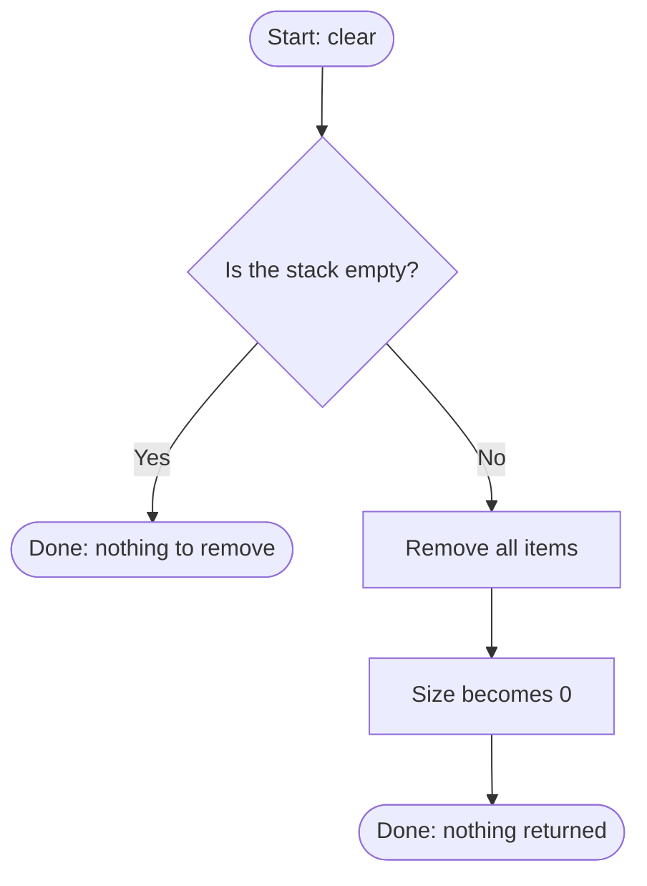

# clear

Removes all items from the stack.

## Before / after

| | Stack (bottom to top) | Size |
|---|---|---|
| Before | `[1, 2, 3]` | 3 |
| After `clear()` | `[]` | 0 |
| Empty before | `[]` | 0 |
| Empty after `clear()` | `[]` | 0 |
