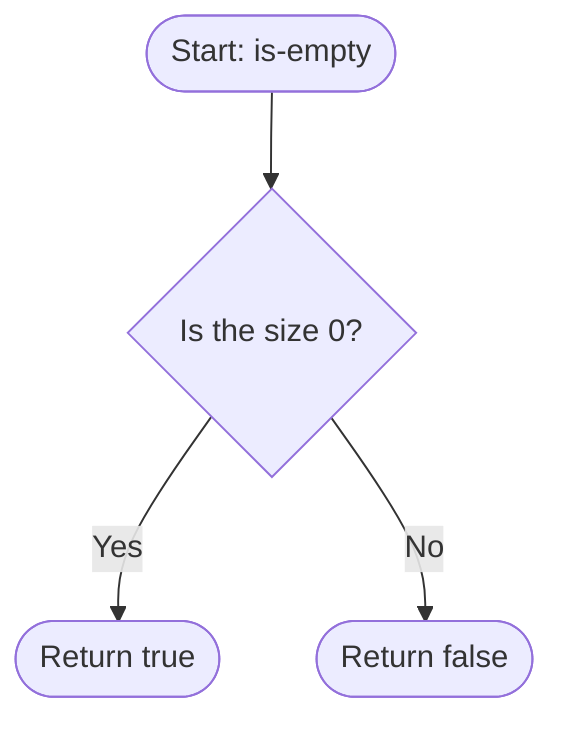

# is-empty

Reports whether the stack holds no items.

## Before / after

| | Stack (bottom to top) | Result |
|---|---|---|
| Before | `[]` | |
| After `is-empty` | `[]` | `true` |
| Before | `[1]` | |
| After `is-empty` | `[1]` | `false` |
