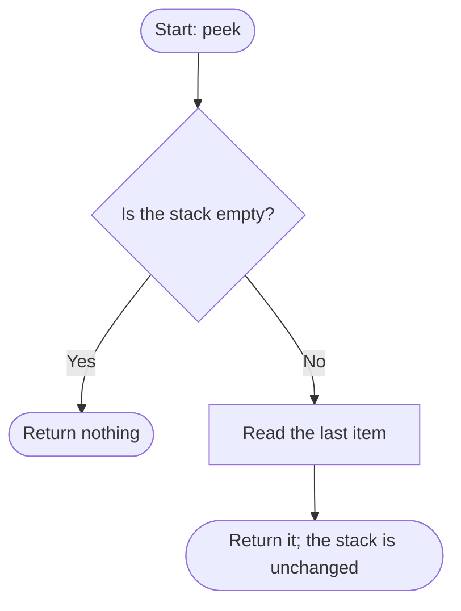

# peek

Returns the top value without removing it, or nothing if the stack is empty.

## Before / after

| | Stack (bottom to top) | Size | Result |
|---|---|---|---|
| Before | `[1, 2, 3]` | 3 | |
| After `peek()` | `[1, 2, 3]` | 3 | `3` |
| Empty before | `[]` | 0 | |
| Empty after `peek()` | `[]` | 0 | nothing |
