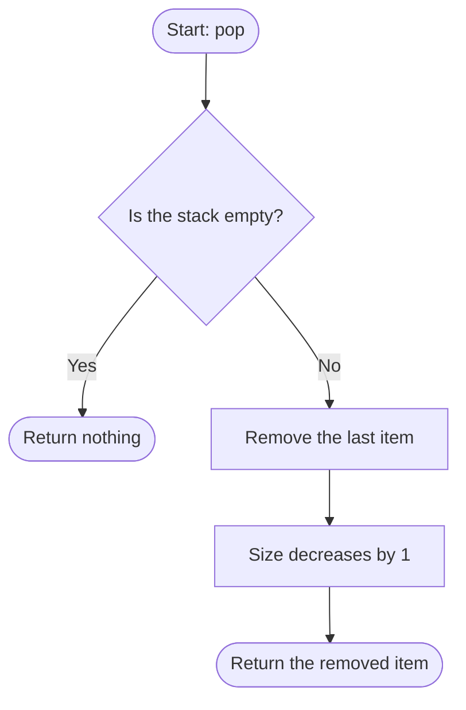

# pop

Removes and returns the top value, or nothing if the stack is empty.

## Before / after

| | Stack (bottom to top) | Size | Result |
|---|---|---|---|
| Before | `[1, 2, 3]` | 3 | |
| After `pop()` | `[1, 2]` | 2 | `3` |
| Empty before | `[]` | 0 | |
| Empty after `pop()` | `[]` | 0 | nothing |
