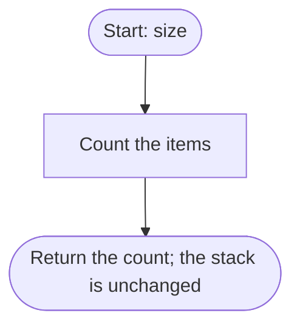

# size

Returns the number of items in the stack.

## Before / after

| | Stack (bottom to top) | Result |
|---|---|---|
| Before | `[1, 2, 3]` | |
| After `size` | `[1, 2, 3]` | `3` |
| Before | `[]` | |
| After `size` | `[]` | `0` |
