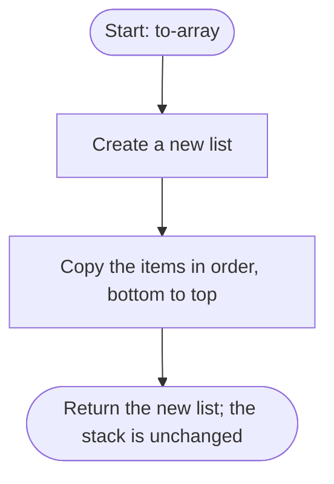

# to-array

Returns a copy of the items, bottom first and top last. Changing the copy does not change the stack.

## Before / after

| | Stack (bottom to top) | Result |
|---|---|---|
| Before | `[1, 2, 3]` | |
| After `to-array` | `[1, 2, 3]` | copy `[1, 2, 3]` |
| After changing the copy | `[1, 2, 3]` | copy `[1, 2, 3, 4]` |
